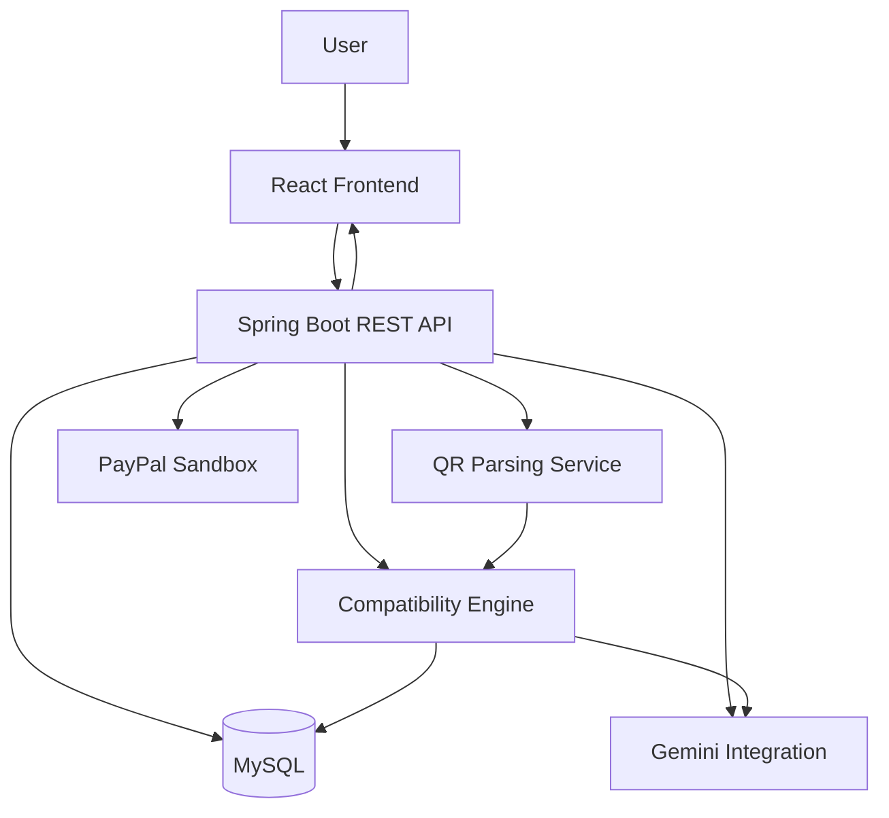

# 🌉 PayBridge AI
### One Payment Ecosystem. Multiple Possibilities. One Intelligent Bridge.

<p align="center">
  <strong>Making payment compatibility understandable through AI, intelligent evaluation, and fintech engineering.</strong>
</p>

---

## 💡 The idea

**What happens when a payment QR code meets a payment ecosystem it wasn't designed for?**

A QR code might contain valid payment information, but that doesn't automatically mean every payment application or network can process it.

Payment interoperability is more than scanning a QR code. It involves understanding payment data, evaluating compatibility, and identifying limitations.

That's where **PayBridge AI** comes in.

PayBridge AI is an AI-assisted payment compatibility platform that brings together QR data analysis, deterministic evaluation, explainable AI, and PayPal Sandbox workflows in one application.

Instead of simply asking *"Can I scan this?"*, PayBridge AI explores a more useful question:

**"What does this payment data tell us, and how compatible is it with the intended payment flow?"**

---

## ⚡ From QR data to an understandable decision

<text> </text>

<box border radius="xl" padding={3} gap={3}>
  <row align="center" justify="between">
    **01 · DECODE**
    <badge color="info">QR Intelligence</badge>
  </row>
  Understand and extract structured information from payment QR input.
  <divider color="subtle" />
  <row align="center" justify="between">
    **02 · EVALUATE**
    <badge color="success">Rule-based engine</badge>
  </row>
  Evaluate payment compatibility using deterministic application logic.
  <divider color="subtle" />
  <row align="center" justify="between">
    **03 · EXPLAIN**
    <badge color="discovery">Gemini AI</badge>
  </row>
  Turn technical evaluation results into human-readable explanations.
  <divider color="subtle" />
  <row align="center" justify="between">
    **04 · EXPLORE**
    <badge>Payment workflows</badge>
  </row>
  Test payment order creation and capture through PayPal Sandbox.
</box>

## 🧠 The compatibility engine

Not every evaluation should be reduced to a simple yes or no.

PayBridge AI uses three evaluation outcomes:

<box border radius="lg" padding={3} gap={3}>
  <row align="center" gap={2}>
    <badge color="success">COMPATIBLE</badge>
    **Compatibility conditions satisfied**
  </row>
  The evaluated data meets the application's defined compatibility rules.
  <divider color="subtle" />
  <row align="center" gap={2}>
    <badge color="warning">CONDITIONAL</badge>
    **Additional conditions apply**
  </row>
  The evaluation identifies limitations or conditions that need consideration.
  <divider color="subtle" />
  <row align="center" gap={2}>
    <badge color="secondary">UNVERIFIED</badge>
    **Compatibility not established**
  </row>
  Available information is insufficient to establish compatibility.
</box>

**Why this matters:** The compatibility verdict comes from deterministic application logic. Gemini AI helps explain the result; it does not replace the evaluation engine or independently authorize a payment.

## ✨ What makes PayBridge AI different?

| Capability | What it brings |
|---|---|
| QR data intelligence | Converts payment QR input into structured information |
| Compatibility evaluation | Provides explicit, rule-based evaluation outcomes |
| AI explanations | Makes technical results easier to understand |
| PayPal Sandbox | Demonstrates order creation and capture workflows |
| RouteIQ dashboard | Presents and organizes evaluation information |

### A deliberate separation of responsibilities

One important engineering decision is that payment compatibility and AI explanations are separate responsibilities.

```text
                 PAYMENT QR
                      |
                      v
                QR PARSING
                      |
                      v
             COMPATIBILITY ENGINE
                      |
             DETERMINISTIC RESULT
                      |
                      v
                GEMINI AI
                      |
                      v
             HUMAN-READABLE INSIGHT
```

This avoids treating an AI-generated explanation as a payment authorization or compatibility decision.

---

## 🏗️ Under the hood



## 🛠️ Technology choices

| Layer | Stack |
|---|---|
| User interface | React 19, Vite 8 |
| Styling | Tailwind CSS 4 |
| Interactive components | AG Grid Community, Lucide React, Motion |
| Backend services | Java 21, Spring Boot 3.4.3 |
| Persistence | MySQL, Spring Data JPA, Hibernate |
| AI layer | Google Gemini API |
| Payment testing | PayPal Sandbox |
| Build and packaging | Maven, npm, Docker |

## 🔌 API at a glance

| Method | Endpoint | Purpose |
|---|---|---|
| `GET` | `/api/health` | Check backend health |
| `POST` | `/api/qr/parse` | Parse payment QR input |
| `POST` | `/api/compatibility/evaluate` | Evaluate compatibility |
| `POST` | `/api/ai/explain` | Generate AI explanation |
| `GET` | `/api/evaluations` | Retrieve evaluations |
| `POST` | `/api/payments/orders` | Create Sandbox order |
| `POST` | `/api/payments/orders/{orderId}/capture` | Capture Sandbox order |

## 📂 Repository map

```text
PayBridge-AI/
│
├── backend/
│   ├── src/
│   │   └── main/
│   │       ├── java/
│   │       └── resources/
│   ├── Dockerfile
│   └── pom.xml
│
├── frontend/
│   ├── src/
│   ├── public/
│   └── package.json
│
├── docs/
│   ├── API_CONTRACT.md
│   ├── ARCHITECTURE.md
│   └── TEST_PLAN.md
│
├── README.md
└── LICENSE
```

## 🚀 Run it locally

### Requirements

- Java 21
- Maven
- Node.js and npm
- MySQL
- Gemini API key
- PayPal Sandbox credentials

### 1. Clone

```bash
git clone https://github.com/asthasingh18/PayBridge-AI.git
cd PayBridge-AI
```

### 2. Configure the backend

```bash
cd backend
```

Copy `application-local.properties.example` to `application-local.properties` and configure your local credentials:

```properties
spring.datasource.username=root
spring.datasource.password=YOUR_MYSQL_PASSWORD

GEMINI_API_KEY=YOUR_GEMINI_API_KEY

PAYPAL_CLIENT_ID=YOUR_PAYPAL_CLIENT_ID
PAYPAL_CLIENT_SECRET=YOUR_PAYPAL_CLIENT_SECRET
```

Never commit private credentials.

### 3. Start Spring Boot

```bash
mvn spring-boot:run
```

Default backend port: `8081`.

### 4. Start React

Open another terminal:

```bash
cd frontend
npm install
npm run dev
```

### 5. Create a production frontend build

```bash
npm run build
```

---

## 🔐 Engineering considerations

- Deterministic compatibility evaluation is kept separate from AI-generated explanations.
- PayPal Sandbox operations are separate from QR compatibility evaluation.
- External credentials are configured outside committed source code.
- The backend requires access to a reachable MySQL instance.
- Docker packaging is provided for backend deployment.

## 🔭 Where PayBridge AI can go next

- Expand QR-format recognition and validation.
- Add compatibility rules for more payment ecosystems.
- Improve explanation traceability.
- Expand automated integration and security testing.
- Introduce production monitoring and deployment.
- Explore additional payment-provider integrations.

## 📌 Project scope

PayBridge AI is a fintech hackathon project demonstrating payment QR analysis, rule-based compatibility evaluation, AI-assisted explanations, and PayPal Sandbox workflows.

It does not claim universal payment interoperability, direct cross-border UPI settlement, or production-grade real-money payment processing.

---

## 👩‍💻 Built with curiosity

**PayBridge AI**

*Because understanding a payment should come before attempting one.*

